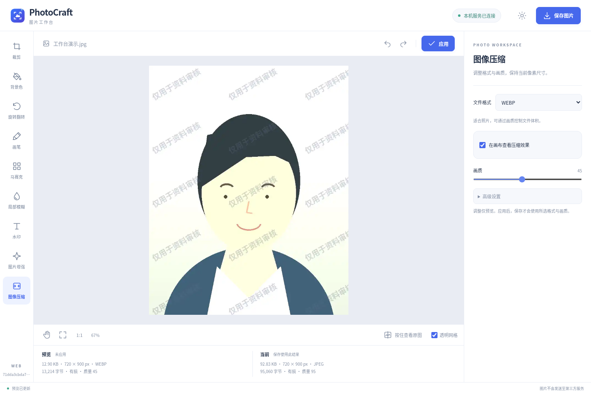

# PhotoCraft Web

一个可自行部署的图片工作台。浏览器负责交互，Python 服务负责完整分辨率的图像处理，网页与后端一起打包为 Docker 镜像。



图片只发送至你连接的 PhotoCraft 服务，不调用第三方图片处理服务。本机部署时图片不离开本机；部署到服务器后，图片会上传至该服务器。网页不依赖 CDN，服务运行后无需连接外网。

## 启动

安装 Docker 与 Docker Compose，在项目目录运行：

```bash
docker compose build --build-arg VCS_REF="$(git rev-parse HEAD)"
docker compose up -d
```

打开 **http://localhost:8000**。默认只监听本机，网页、接口与图片下载使用同一个地址，无需单独启动前端或安装 Node.js、Qt。

```bash
docker compose logs -f
docker compose down
```

Compose 启动时会将宿主机字体目录只读挂载到容器，默认目录为 `/usr/share/fonts`。如果该目录不存在，请先在项目 `.env` 中设置 `PHOTOCRAFT_FONTS_DIR` 为本机已有的字体目录，例如 macOS 的 `/System/Library/Fonts` 或 Windows 的 `C:/Windows/Fonts`。不要求安装特定字体，水印可用字符取决于所选系统字体。

镜像默认使用华为云基础镜像源和清华 PyPI 镜像，首次构建需要联网下载依赖。

配置保存在命名卷 `photocraft-config`，正常停止或重建不会清除。照片、预览和撤销记录仅保留在服务内存中；刷新页面或重启服务后，需要重新打开图片。

也可以用构建脚本自动带入当前 Git commit、tag 与工作区状态：

```bash
python scripts/build_image.py --tag photocraft:local
docker compose up -d --no-build
```

镜像构建和运行方式见 [部署说明](docs/RELEASING.md)。

## 使用

1. 点击欢迎页选择图片，或将一张图片拖入页面。`Ctrl+O` 也可打开，支持 JPG、PNG、WEBP、BMP、TIFF。
2. 在左侧选择工具，裁剪、画笔、马赛克、模糊、调整、图像增强和水印的参数均位于照片下方，点击按钮展开，点击外部或按 `Esc` 收起；图像压缩使用右侧面板。
3. 裁剪、旋转、图像增强、水印和压缩先预览，点击上方「应用」后进入当前结果。「调整」中的参数修改后自动应用，画笔、马赛克和模糊松开后自动应用。
4. 顶部视图栏与撤销、重做位于同一栏。「适应窗口 / 实际大小」下拉菜单控制显示大小，滚轮可自由缩放，空格拖动平移。按住「查看原图」临时比较，松开恢复之前的视图。「透明网格」只用于辨认透明区域，不会保存到图片中。
5. 页脚中间连续显示预览的体积、尺寸、格式、画质和缩放百分比，悬停图片信息可查看详细编码信息。
6. 打开「保存图片」下拉菜单，选择「保存图片」（默认）、「另存为」或「复制到剪贴板」。**三种操作都只使用已应用的结果，未应用的预览不会保存或复制。**

「保存图片」下载服务端已经编码的完整结果，不重复处理。支持系统文件选择器的浏览器可通过「另存为」选择保存位置；其他浏览器提供文件名输入框后下载。「复制到剪贴板」复制完整分辨率的 PNG 图片，需要浏览器支持图片剪贴板，并通过 HTTPS 或本机地址访问。

| 快捷键 | 操作 |
| --- | --- |
| `Ctrl+O` | 打开图片 |
| `Ctrl+S` | 保存图片 |
| `Ctrl+Shift+S` | 另存为 |
| `Ctrl+Z` / `Ctrl+Shift+Z` | 撤销 / 重做 |
| `Ctrl+0` | 适应窗口 |
| 按住空格并拖动 | 平移图片 |
| 滚轮 | 缩放图片 |
| `Esc` | 关闭参数弹窗或对话框 |

顶部「帮助」提供使用说明；macOS 使用 ⌘ Command 替代 Ctrl。

## 功能

| 功能 | 行为 |
| --- | --- |
| 裁剪 | 常用证件照模板、自由裁剪、自定义比例；按比例默认 16:9。自由裁剪的像素输入与画布联动。 |
| 模板 | 使用管理员预设的裁剪规格；网页不提供新增或修改模板。 |
| 缩放控制 | 默认不允许缩放，模板取景框保持指定像素大小、只能移动。像素不足时应用会报错；勾选后才允许缩放。放大可能模糊，缩小会损失细节。 |
| 裁剪与旋转 | 共用功能入口；底部面板分为两行：第一行是刻度，第二行包含全部参数与旋转、翻转按钮。刻度条支持 −180°～180° 旋转，拖动时按间隔更新预览，左下方左旋 / 右旋 90°，右下方上下 / 左右翻转。旋转始终保留完整画面，调整后点击「应用」。 |
| 画笔与局部处理 | 绘制、透明擦除、马赛克、局部模糊；参数位于照片下方，编辑时隐藏右侧面板。画笔分为画笔、橡皮擦，大小、透明度和颜色收在对应弹窗中，大小范围 1–100 px。「移除标记」单击撤销上一笔，长按撤销当前连续绘制的全部笔迹，不跨越裁剪等其他编辑。松开画笔后自动应用。 |
| 文字水印 | 底部按「文字与字体、样式、排布」分组；样式弹窗内提供常用色板、取色器和十六进制输入。支持字号、不透明度、倾斜角度和行列间距，实时预览默认开启。字体来自系统，不要求特定字体。最多 50 字，默认替换已有水印，底部「多重水印」开关允许叠加，最多 10 组；支持清除已应用水印。 |
| 调整 | 照片下方按光线、颜色、细节分组，点击按钮展开滑块；自动对比度与自动白平衡使用切换按钮，与对应手动项互斥。一段连续滑动合并为一次撤销。 |
| 图像增强 | 鲜明、暖阳、冷调、柔和、复古、黑白、戏剧等风格模板；底部只显示「滤镜」与「强度」两个按钮，点击滤镜向右展开选项，窄屏可横向滑动；缩略图等比完整显示照片。画布显示实际效果，点击「应用」后生效，可撤销；模板替换当前色彩调整，应用后可在「调整」中微调。 |
| 图像压缩 | JPEG、PNG、WEBP、BMP、TIFF；仅调整格式、画质、透明和元数据设置，不更改图片尺寸，不限制或搜索目标文件体积。 |

JPEG / WEBP 的画质会影响文件体积与细节，质量 100 仍然使用有损编码。PNG、BMP、TIFF 使用无损编码；不支持透明的格式会填充背景色，并在信息中标明透明信息损失。未修改的图片直接下载原文件字节，避免隐式重新编码。

预览显示图最长边限制为 1600 px，下载仍使用完整分辨率。连续调整会合并请求，过期预览不会覆盖新状态；应用时复用有效预览的完整结果。每张照片拥有独立会话，不同浏览器页面的图像和撤销记录互不混用。

更多界面：[欢迎页](docs/screenshots/web/welcome.png) · [裁剪](docs/screenshots/web/crop.png) · [文字水印](docs/screenshots/web/watermark.png) · [深色主题](docs/screenshots/web/dark.png) · [手机布局](docs/screenshots/web/mobile.png) · [颜色面板](docs/screenshots/web/colors.png)。

## 浏览器与通信

面向当前 Chrome、Firefox 与 Safari。CI 使用 Chromium、Firefox、WebKit 三种引擎验证打开、预览、颜色选择、编辑、下载及手机布局。WebKit 自动化是 Safari 引擎的回归检查，不等于 macOS / iOS Safari 实机测试；上线前应在目标设备补验。

前后端使用同源 HTTP API，通过 JSON 传递操作、HTTP 传输图片，不使用 WebSocket。反向代理启用 HTTPS 后，浏览器与服务之间使用 HTTPS。每次预览请求返回处理完成的实测结果；滑动调整会防抖并合并待处理请求。

服务会保留完整分辨率的当前结果、最多 2 个预览和有预算的撤销历史，以便应用与保存复用，不能在每次请求结束后清空。应用或撤销后清除旧预览；会话默认闲置 1 小时过期，每分钟定期回收，并在请求时检查。正常离开页面会尽力通知服务释放；浏览器崩溃、断网等情况由过期回收兜底。详细限制见 [配置说明](docs/CONFIGURATION.md)。

## 配置

云端页面不提供菜单、配置管理或新增模板，也没有对应的配置读取和修改 HTTP 接口。部署管理员可编辑容器持久卷内的 `/data/PhotoCraft.conf`（UTF-8 TOML），重启服务后生效。预设模板、默认颜色等由服务共享；图片编辑参数仅影响各自会话，主题可在浏览器单独切换。

源码运行可通过 `PHOTOCRAFT_CONFIG_DIR` 指定目录；未指定时，Linux 使用 `~/.config/PhotoCraft`，Windows 使用 `%APPDATA%\PhotoCraft`。示例见 [examples/PhotoCraft.conf](examples/PhotoCraft.conf)，详情见 [配置说明](docs/CONFIGURATION.md)。

## 源码运行

需要 Python 3.12+：

```bash
python -m venv .venv
# Linux / macOS
source .venv/bin/activate
# Windows PowerShell：.venv\Scripts\Activate.ps1
python -m pip install -i https://pypi.tuna.tsinghua.edu.cn/simple -r requirements-lock.txt
python -m pip install --no-deps -e .
python -m photocraft --host 127.0.0.1 --port 8000
```

字体从服务所在系统读取，不依赖特定字体或操作系统。容器可将管理员选择的字体目录只读挂载至 `/usr/local/share/fonts`；未发现系统字体时使用 Pillow 默认字体，字符覆盖取决于可用字体。前端是随包分发的 HTML、CSS、JavaScript，不需要 npm 构建。

## 检查与 CI

GitHub Actions 仅使用 Ubuntu 运行 Python 检查和容器检查，不包含 Windows 任务。容器流程还使用 Chromium、Firefox、WebKit 检查浏览器交互。测试不要求安装某个特定字体。

本地检查：

```bash
python -m pip install -i https://pypi.tuna.tsinghua.edu.cn/simple -r requirements-dev.txt
ruff check .
python -m pytest -q
python scripts/smoke_web.py --spawn
```

浏览器回归需要 Node.js，以及已经运行的服务（默认 `http://127.0.0.1:8000`）：

```bash
npm ci --registry=https://registry.npmmirror.com
npx playwright install --with-deps chromium firefox webkit
npm run test:web
```

可通过 `PHOTOCRAFT_BASE_URL` 指定服务地址，`PHOTOCRAFT_BROWSERS=chromium` 仅检查 Chromium。浏览器安装仍需下载 Playwright 对应的引擎，npm 镜像仅负责 npm 依赖。

## 运行边界

- 这是单个可信工作台服务，不提供账号、多人协作或项目文件保存。对外部署时应在反向代理设置 HTTPS 与访问控制；默认 Compose 端口仅对本机开放。
- 默认最多同时保留 4 个会话；单张图片上限 40 MB、2400 万像素。闲置会话 1 小时过期，后台定期释放。单个会话的撤销缓存有内存预算。
- 图片重启后不保留；配置卷保留。服务没有将用户照片保存到持久卷，上传解析产生的临时文件会及时删除。
- 下载保存位置由浏览器处理；支持系统文件选择器时，「另存为」可写入用户明确选定的文件。打开与编辑图片本身不会覆盖原文件。
- 没有自动人像分割、AI 超分或 AI 去噪；需要「背景替换」时，可使用微软照片，帮助页也有醒目提示。多帧 TIFF / 动图只处理第一帧。
- 旧 Qt 界面和原生打包脚本保留为可选的历史入口，不属于 Web 镜像依赖；当前 CI 和 tag 发布以 Web 服务与镜像为主，不再发布 deb / Windows 安装器。

## 考试照片裁剪模板

内置教师资格考试参考尺寸（150 × 200 px）与国家公务员考试参考尺寸（295 × 413 px）。裁剪模板只决定输出像素，不自动验证背景颜色、人物构图、文件格式、体积或报名审核结果。

教资 150 × 200 px 见[北京教育考试院历史公告](https://www.bjeea.cn/html/fxlks/shdjks/tzgg/2024/0626/85440.html)，不是所有地区、年份的统一像素标准；[2026 年下半年浙江公告](https://gaokao.neea.edu.cn/html1/report/2606/49-1.htm)要求白底、JPG/JPEG、不超过 200KB。请以报考地当次要求为准。

[国考报考指南](https://shanghai.chinatax.gov.cn/tax/xxgk/rsxx/202610/t481764.html)要求源照片宽至少 295 px、高至少 413 px，蓝底或白底，JPG/JPEG，仍需官方照片处理工具处理。省考请核对当地公告。

项目许可见 [LICENSE](LICENSE)，依赖与字体说明见 [THIRD_PARTY_NOTICES.md](THIRD_PARTY_NOTICES.md)。
