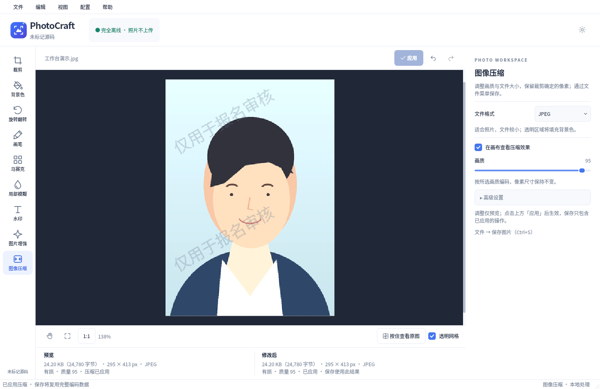

# PhotoCraft

离线照片工作台，面向报名头像、证件照和日常图片编辑。基于 Python、Qt Widgets、Pillow 与 NumPy，提供 Linux 和 Windows 桌面版本。



## 启动

需要 Python 3.12+。推荐 Ubuntu 22.04+ / Debian 12+（x86_64），Windows 10/11 x64。

```bash
python -m venv .venv
# Linux
source .venv/bin/activate
# Windows PowerShell: .venv\Scripts\Activate.ps1
python -m pip install -r requirements-lock.txt
python -m pip install --no-deps -e .
python -m photocraft
```

Ubuntu 若缺少 venv：`sudo apt install python3-venv`。Linux 推荐安装 `fonts-noto-cjk` 以完整显示中文。Qt 平台依赖见 [构建和发布](docs/RELEASING.md)。应用运行不连接网络，也不下载模型。

## 使用

1. 选择或拖入图片，或按 `Ctrl+O` 打开。滚轮缩放；空格或鼠标中键平移；`Ctrl+0` 适应窗口，`Ctrl+1` 原始像素显示。
2. 在「裁剪」中选择 1 寸、2 寸、小 1 寸模板，目标像素固定且只读。默认不勾选「允许缩放」，取景框按模板像素固定大小，只能移动；图片像素不足时点击「应用」会弹窗报错，不会修改图片。例如 1 寸图片不能直接变成 2 寸，可先撤销裁剪，从原图重新裁。勾选「允许缩放」后可调整取景范围，再缩放为模板尺寸；放大可能模糊，缩小会丢失细节。点击画布上方统一的「应用」，底部「当前」同步显示真实尺寸。也可选择「自由裁剪」或「按比例裁剪」，后者自行输入宽高比例，两者应用后沿用裁剪框像素。应用后退出裁剪状态；再次选择裁剪可开始新裁剪。
3. 在左侧选择裁剪、背景色、旋转翻转、画笔/橡皮擦、马赛克、局部模糊、水印或增强。`Ctrl+Z` 撤销，`Ctrl+Shift+Z` 重做；按住「查看原图」时完整显示原图，松开恢复之前的缩放和位置。
4. 在「图像压缩」选择格式和画质，始终保持当前编辑图片的像素尺寸。「在画布查看压缩效果」位于格式说明下方。参数停止调整 300 ms 后自动编码预览，底部「预览」列显示真实格式、体积、精确字节数和是否有损；不设置文件体积上限、不自动降质或 PNG 减色。点击上方「应用」后，底部「当前」才更新为该结果，继续调整参数不会覆盖已应用的信息。通过「文件 → 保存图片」（`Ctrl+S`）保存已应用的结果，任何功能页均可操作。未应用的压缩参数、裁剪框、旋转角度、水印和背景色只用于预览，不参与保存。未应用过压缩时沿用原格式；应用后使用上次已应用的压缩设置，后续像素编辑也保留该设置。透明与元数据选项位于「高级设置」。原始文件只有在显式选择同路径并确认覆盖时才会改变。

## 功能

- 裁剪面板按方式选择、尺寸、缩放选项分区展示。点击「新增模板」，在弹窗填写名称、宽度和高度（px），保存后自动选中；支持在自由裁剪、按比例裁剪时新增。模板名称不可重复，取消不写入配置，新增不修改照片。
- JPG/JPEG、PNG、WEBP、BMP、TIFF 导入与导出；EXIF 方向纠正、ICC 转换与导出选项。
- 证件照与通用裁剪共用「裁剪」入口。下拉包含常用证件照 / 自定义规格模板、自由裁剪和按比例裁剪。模板控制最终输出像素；自由裁剪输入源像素宽高，与裁剪框实时双向联动；按比例裁剪默认 16:9，可自行修改，只限定形状。
- 「背景色」为独立的左侧功能，通过「填充颜色」打开颜色选择器，不额外展开基础颜色快捷按钮。为透明或半透明区域填充颜色，后台合并预览，显示长边不超过 1600 px；点击上方「应用」后修改图片，支持撤销、重做。保留水印与增强参数，应用与保存复用完整分辨率结果。不会自动抠图，原本不透明的像素不变。
- 90°/180°/任意角度旋转预览，自动扩展画布，水平/垂直翻转。任意角度预览在后台合并计算，过期结果丢弃，显示缩略图长边限制为 1600 px。
- 画笔、透明擦除、局部马赛克和局部模糊；通过滑动条调整大小、透明度及块大小，画笔大小范围为 1–100 px，支持撤销。拖动画笔使用长边不超过 1600 px 的缓存底图预览，松开鼠标后按完整分辨率应用。
- 整页平铺文字水印，从系统字体中选择，文字数量限制悬浮可见，超长输入会被整体拒绝并提示，不显示常驻字数计数；默认半透明灰色、倾斜 30°。不透明度、角度、行间距、列间距均使用滑动条，间距表示相邻水印外框之间的空白（原图像素）。勾选「实时预览」后随调整显示效果，点击上方「应用」才参与导出。默认替换全部已有水印；勾选「允许多重水印」后，每次应用叠加一组，最多 10 组，可清除和撤销。预览每 150 ms 合并更新，后台最多运行一个预览任务，预览长边限制为 1600 px；导出仍使用完整分辨率。
- 图片增强调整即生效，滑块保留当前位置；切换工具、裁剪、画笔和导出均保留参数，每次从未增强的底图计算，避免重复叠加。对比度可选自动、色温可选自动白平衡，自动启用时停用该项手动值，取消后恢复。降噪和明暗均衡使用 0–100% 强度滑块。一次滑块拖动作为一次撤销，撤销 / 重做同步恢复参数；「恢复默认参数」也可撤销。
- 增强预览、底部信息和保存共用完整分辨率的增强与水印合成缓存，同一状态的并发计算合并；修改压缩参数只重新编码。已有有效的已应用编码数据时，保存直接写入这些字节；普通编辑的底部实测结果也可复用，未应用的压缩预览不会用于保存；仅切换工具、缩放或主题不会清除有效预览。保存使用独立写入线程，不排在后台预览后等待，也不生成不需要的屏幕缩略图。打开后未进行任何编辑或撤销回原图、且未应用过压缩时，保存复用打开时保留的原文件字节，避免隐式重新压缩。保存成功在状态栏提示，磁盘写入与校验仍保留。
- 图像压缩只提供格式、画质和编码相关选项。调整后自动预览真实编码图像，同时最多运行一个压缩任务，过期结果丢弃，避免队列堆积。保存入口位于文件菜单，屏幕缩略图不参与保存。
- 底部固定分为「预览」和「当前」两列，统一显示实测体积、精确字节数、像素、格式与有损状态。「预览」对应当前功能的草稿，包括裁剪、水印、背景色、旋转、笔触和压缩；「当前」只显示已应用、会参与保存的结果，草稿变化不会覆盖该列。原文件信息放在文件名悬浮提示中。信息计算在后台合并，单次只测量一个预览，过期结果丢弃；关闭预览时显示与当前一致的信息。
- 画布上方统一提供一个「应用」按钮，按当前工具执行裁剪、背景填充、角度、水印或压缩；属性页只提供参数，不再独立展示预览结果或应用按钮。图片增强仍调整即应用，画笔松开即应用，这些功能无需重复确认。
- 背景色会检测透明通道：JPG 或完全不透明的 PNG 显示无透明区域提示，禁用无效应用，不产生撤销记录；有透明或半透明区域时正常填色。左侧底部直接显示 Git tag / commit 版本文字，可悬浮查看和选择复制；关于窗口仍可从帮助菜单打开。
- 可编辑、可持久保存的自定义规格模板；浅色/深色主题；高 DPI；后台编码与进度反馈。
- 原创矢量 Logo，统一应用窗口、任务栏、开始菜单、桌面快捷方式及安装程序图标。

证件照模板默认按指定像素裁剪，仅勾选「允许缩放」后才进行目标像素调整，作为一步操作支持撤销和重做。只选择模板或修改模板配置不会改变当前照片或保存尺寸。压缩和保存始终使用当前编辑图片的实际像素，旋转、撤销后也不会被模板尺寸再次覆盖。自由裁剪和按比例裁剪直接沿用裁剪框像素。格式与画质在「图像压缩」中设置，选择裁剪模板不会覆盖这些参数。DPI 沿用原图的有效标注，没有有效值时使用 300；WEBP 不写入 DPI。

「新增模板」弹窗中可设置名称和像素宽高；模板不保存照片、裁剪位置或编辑结果。已有模板可通过「配置 → 编辑配置」修改。按比例裁剪限制形状，应用后直接使用裁剪结果的像素尺寸。

水印文字与输入框采用左右排列。颜色窗口预置黑、白、灰、红、蓝等 16 个自定义色槽；修改色槽后会自动写入配置，下次打开继续使用。上次选中的水印颜色也会保存，支持随配置导入、导出与重置。

## 配置与菜单

配置文件名保持 `PhotoCraft.conf`，内容为 TOML：Linux 默认 `~/.config/PhotoCraft/PhotoCraft.conf`，Windows 为 `%APPDATA%\PhotoCraft\PhotoCraft.conf`；源码和打包程序使用相同逻辑。窗口状态单独保存在 `state.toml`。旧 QSettings 配置不再迁移，旧格式先留回退副本再用默认配置替换；上一版 `config.toml` 会停用。

可见菜单提供文件、编辑、视图、配置、帮助。「配置」支持内置编辑器（`Ctrl+,`）、导入、导出、重新加载（`F5`）、打开目录和恢复默认设置。编辑、导入先校验再写入，立即应用主题与模板，不改变当前照片像素。每个 `[[crop.templates]]` 块对应一个下拉模板，可以直接修改或删除。

配置示例和操作说明见 [docs/CONFIGURATION.md](docs/CONFIGURATION.md)。

## 压缩规则

- `1 KB = 1024 bytes`；显示实际编码字节数，不预估体积。
- JPEG / WEBP 严格使用滑块选定的画质，不搜索或自动降低质量，不限制文件体积；即使质量 100，当前编码方式仍然有损。
- PNG 无损压缩，不自动减色；BMP / TIFF 使用无损编码。导出时填充透明区域会标明信息损失原因。
- 始终保持当前图片的实际像素尺寸。WEBP 不写入 DPI；不支持透明的格式使用所选颜色合成。
- 模板尺寸转换在应用裁剪时完成一次；压缩和保存不再执行模板缩放。
- 保存采用同目录临时文件，写入后重新打开验证，再原子发布；已有文件须确认覆盖。

## 当前边界

- 本次交付 Linux / Windows。Android 尚未实现移动界面或 APK 构建，不能将桌面安装包用于手机。
- 背景填充只处理透明像素；没有自动人像分割、AI 超分或 AI 去噪。`photocraft/plugins.py` 提供可选处理器协议，基础功能不依赖它们。
- 不提供可恢复的工程文件格式。当前会话保留原图、独立水印与受内存限制的撤销记录；关闭后只保存导出的扁平图片和用户模板。
- 多帧 TIFF / 动图只读取第一帧。
- 编码在后台执行，当前任务完成前需等待再退出；暂未提供中途取消。大图某些像素编辑仍可能短暂占用界面线程。
- 未配置 Windows 代码签名证书，安装包未签名。远程 Windows 安装器应以 GitHub Actions 构建结果为准。

代码与原创资产采用 [MIT](LICENSE)，依赖声明见 [THIRD_PARTY_NOTICES.md](THIRD_PARTY_NOTICES.md)。
